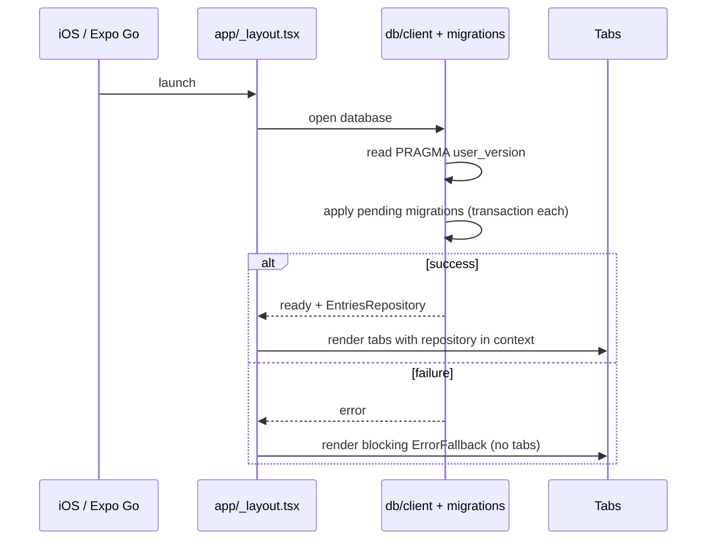
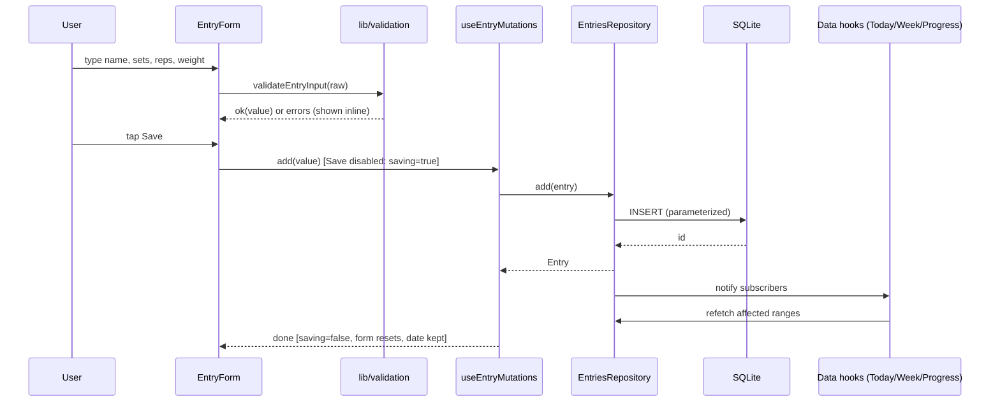
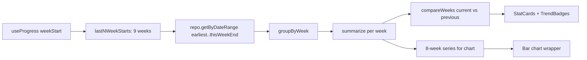

# Workout Tracker — System Architecture

| | |
|---|---|
| **Status** | Proposed v1.0 (for Phase 0 onward) |
| **Scope** | iPhone app, single user, offline, no backend |
| **Companion docs** | `PRD.md` (what), `plan.md` (phases), `CLAUDE.md` (coding rules) |

---

## 1. Context and constraints

| Constraint | Consequence for the architecture |
|---|---|
| One user, one device, no accounts | No backend, no auth, no sync. Data lives on the phone |
| Must work offline | Local SQLite is the system of record |
| Correct numbers are the core value | Domain rules isolated in pure, heavily tested functions |
| Developed on Windows, tested on iPhone via Expo Go | Only Expo-Go-compatible libraries; no custom native code |
| Small app, must actually get finished | Few moving parts; no state-management framework unless needed |
| Data is only on the device | CSV export is a first-class backup path |

**Architecture style:** *functional core, imperative shell*. All business rules live in a pure core with no I/O. A thin layer of repositories, hooks and screens connects that core to SQLite and the UI.

---

## 2. System overview

```
┌──────────────────────────── iPhone (Expo Go / EAS build) ────────────────────────────┐
│                                                                                      │
│  PRESENTATION      app/ (Expo Router screens)  ·  src/components/  ·  src/theme/     │
│        │                                                                             │
│        ▼                                                                             │
│  APPLICATION       src/hooks/   (useEntries, useWeekSummary, useProgress, ...)       │
│        │               │                                                             │
│        │               └──────────────► DOMAIN CORE  src/lib/  (PURE, no I/O)        │
│        ▼                                  dates · weeks · metrics · compare ·        │
│  DATA ACCESS       src/db/                validation · format · csv                  │
│   EntriesRepository ─► SqlExecutor ─► expo-sqlite ─► on-device SQLite file           │
│        ▲                                                                             │
│        └── migrations.ts (versioned via PRAGMA user_version)                         │
│                                                                                      │
│  PLATFORM ADAPTERS  expo-file-system + expo-sharing (CSV)  ·  datetimepicker         │
│                     chart library (behind wrapper components)                        │
└──────────────────────────────────────────────────────────────────────────────────────┘
        No network. No backend. No third-party data collection.
```

### Dependency rule (enforced by lint)
Dependencies point **inward** toward the domain core:

```
app/ ──► components/ ──► hooks/ ──► db/ ──► lib/
                           └────────────────► lib/
```

| Layer | May import | Must not import |
|---|---|---|
| `src/lib` | nothing (only TypeScript std lib) | React, Expo, `db`, `hooks`, `components` |
| `src/db` | `lib` (types only) | React, `hooks`, `components`, `app` |
| `src/hooks` | `lib`, `db` | `app`, `components` |
| `src/components` | `lib` (types, formatters), `hooks`, `theme` | `db` directly |
| `app/` | everything above | — |

Enforce with ESLint `no-restricted-imports` (or `eslint-plugin-boundaries`). A violation fails `npm run check`.

---

## 3. Layers and modules

### 3.1 Domain core — `src/lib` (pure)
No side effects, no clock reads, no I/O. Every function is deterministic and unit tested.

| Module | Responsibility | Key exports |
|---|---|---|
| `types.ts` | Shared domain types | `Entry`, `NewEntry`, `DateString`, `WeekSummary`, `Comparison`, `Trend` |
| `dates.ts` | Safe calendar-date math on `YYYY-MM-DD` strings (UTC arithmetic) | `parseLocalDate`, `isValidDateString`, `addDays`, `diffDays`, `todayLocal(now)` |
| `weeks.ts` | Monday–Sunday week logic | `weekStart`, `weekEnd`, `weekRange`, `previousWeekStart`, `nextWeekStart`, `lastNWeekStarts`, `formatWeekLabel` |
| `metrics.ts` | Aggregation | `summarize(entries)`, `groupByWeek(entries)`, `groupByDay(entries)`, `personalBests(entries)` |
| `compare.ts` | Week-over-week comparison | `percentChange`, `trend`, `compareWeeks(current, previous)` |
| `validation.ts` | Input validation and normalization | `validateEntryInput`, `parseWeightInput`, `normalizeExerciseName` |
| `format.ts` | Display formatting | `formatWeight`, `formatVolume`, `formatPercent` |
| `csv.ts` | CSV build / parse (RFC 4180) | `entriesToCsv`, `parseCsv` |

Key types:

```ts
type DateString = string; // 'YYYY-MM-DD', local calendar date (validated at the boundary)

interface Entry {
  id: number;
  exerciseName: string;
  sets: number;          // int > 0
  reps: number;          // int > 0, per set
  weightKg: number | null;
  date: DateString;
}
type NewEntry = Omit<Entry, 'id'>;

interface WeekSummary {
  weekStart: DateString;
  totalSets: number;
  totalReps: number;
  totalVolumeKg: number;
  exerciseCount: number;
}

type Trend = 'up' | 'down' | 'same' | 'no-baseline';
interface MetricComparison { current: number; previous: number; percent: number | null; trend: Trend }
interface Comparison { exercises: MetricComparison; sets: MetricComparison; reps: MetricComparison; volume: MetricComparison }
```

### 3.2 Data access — `src/db`

| Module | Responsibility |
|---|---|
| `sql.ts` | `SqlExecutor` interface — the *only* thing the repository knows about the database |
| `client.ts` | Opens the database via `expo-sqlite`, implements `SqlExecutor`, runs migrations at startup |
| `migrations.ts` | Ordered migration array + runner (`PRAGMA user_version`, one transaction per migration) |
| `entries.ts` | `EntriesRepository` — the **only** place with SQL; maps rows ↔ `Entry` |

```ts
// Narrow seam so the repository can be tested without a phone
interface SqlExecutor {
  run(sql: string, params?: unknown[]): Promise<{ lastInsertRowId: number; changes: number }>;
  all<T>(sql: string, params?: unknown[]): Promise<T[]>;
  first<T>(sql: string, params?: unknown[]): Promise<T | null>;
  transaction<T>(fn: () => Promise<T>): Promise<T>;
}

interface EntriesRepository {
  add(entry: NewEntry): Promise<Entry>;
  update(id: number, entry: NewEntry): Promise<Entry>;
  remove(id: number): Promise<void>;
  getByDateRange(start: DateString, end: DateString): Promise<Entry[]>;
  getByExercise(name: string): Promise<Entry[]>;
  getAll(): Promise<Entry[]>;                       // for CSV export
  distinctExerciseNames(): Promise<string[]>;
  lastForExercise(name: string): Promise<Entry | null>;
  subscribe(listener: () => void): () => void;      // change notification (see 5.2)
}
```

Repository rules:
- Parameterized queries only (no string-built SQL).
- Row mapping validates and converts types once, at the boundary.
- Multi-row changes (rename exercise, CSV import) run in a single transaction.
- It returns plain `Entry` objects; no SQL types or row shapes leak upward.

### 3.3 Application layer — `src/hooks`

| Hook | Provides |
|---|---|
| `useRepository()` | The `EntriesRepository` from context |
| `useEntriesForDate(date)` | Entries for one day + loading/error state |
| `useWeek(weekStart)` | Entries for the week, grouped by day, plus week summary |
| `useProgress(weekStart)` | Current and previous week summaries, `Comparison`, 8-week series |
| `useExerciseHistory(name)` | History, personal bests, weight series |
| `useExerciseNames()` | Autocomplete source |
| `useEntryMutations()` | `add`, `update`, `remove` with saving state and error handling |

Hooks fetch data via the repository, run it through `src/lib`, and return **view-ready data**. They hold no business rules themselves.

### 3.4 Presentation — `app/`, `src/components/`, `src/theme/`

| Area | Contents |
|---|---|
| `app/_layout.tsx` | Root: error boundary, database provider (waits for migrations), repository context, theme |
| `app/(tabs)/` | `index` (Today), `week`, `progress`, `exercises` |
| `app/exercise/[name].tsx` | Exercise detail |
| `src/components/` | `EntryForm`, `EntryRow`, `WeekStrip`, `StatCard`, `TrendBadge`, `ExerciseAutocomplete`, `ConfirmDialog`, `EmptyState`, `ErrorFallback`, chart wrappers |
| `src/theme/` | Color tokens (light/dark), spacing, typography; `useTheme()` built on `useColorScheme()` |

Screens are thin: they call hooks, render components, and handle navigation. No SQL, no domain math.

### 3.5 Platform adapters
Small wrappers so that platform libraries can be swapped without touching screens:

| Adapter | Wraps | Why |
|---|---|---|
| `BarChart`, `LineChart` components | chart library | Chart library is the riskiest dependency in Expo Go; swapping to the fallback changes one file |
| `DatePickerField` | `@react-native-community/datetimepicker` | Same reason; also normalizes output to `DateString` |
| `exportCsv()` | `expo-file-system` + `expo-sharing` | Keeps file I/O out of `src/lib` |

---

## 4. Data architecture

### 4.1 Storage
Single SQLite database file in the app's sandbox, opened through `expo-sqlite`.

```sql
-- migration 1
CREATE TABLE entries (
  id            INTEGER PRIMARY KEY AUTOINCREMENT,
  exercise_name TEXT    NOT NULL,
  sets          INTEGER NOT NULL CHECK (sets > 0),
  reps          INTEGER NOT NULL CHECK (reps > 0),
  weight_kg     REAL    CHECK (weight_kg IS NULL OR weight_kg >= 0),
  date          TEXT    NOT NULL,           -- 'YYYY-MM-DD' local date
  created_at    TEXT    NOT NULL            -- ISO timestamp, audit only
);
CREATE INDEX idx_entries_date ON entries(date);
CREATE INDEX idx_entries_name ON entries(exercise_name COLLATE NOCASE);
```

Design points:
- **Dates are plain strings.** `BETWEEN 'YYYY-MM-DD' AND 'YYYY-MM-DD'` is correct lexicographically and immune to timezone/DST.
- **Derived values are never stored.** Volume, totals and comparisons are computed from entries so they cannot drift out of sync.
- **CHECK constraints are a second line of defense.** Validation in `src/lib` is the first.
- The `entries` table is the only one in v1. Future tables (e.g. workout templates) arrive as new migrations.

### 4.2 Migrations
- Ordered array `[{ version: 1, up: sql }, ...]`.
- Runner reads `PRAGMA user_version`, applies each higher migration **inside a transaction**, then sets `user_version`.
- A failed migration rolls back and the app shows a blocking error screen. It never runs against a half-migrated schema.
- Shipped migrations are never edited.

### 4.3 Querying strategy
| Need | Approach |
|---|---|
| A week's entries | `getByDateRange(weekStart, weekEnd)` |
| Progress (this week, last week, 8-week chart) | **One** query for the earliest-needed week start through this week's end (about 9 weeks), then `groupByWeek` in code |
| Exercise history | `getByExercise(name)` (NOCASE) |
| Autocomplete | `SELECT DISTINCT exercise_name ... ORDER BY MAX(date) DESC` |
| CSV export | `getAll()` ordered by date then id |

At the expected scale (about 5,000 entries over years) fetch-and-aggregate in code is fast, and it keeps one tested implementation of the metrics rules.

### 4.4 Backup
CSV export is the only backup path in v1 (deleting the app deletes the data). Format: `date,exercise,sets,reps,weight_kg`, UTF-8, RFC 4180 quoting.

---

## 5. Runtime behavior

### 5.1 App startup


### 5.2 Keeping screens fresh after changes
All screens read from SQLite, so every write must refresh any screen showing affected data.

- The repository exposes `subscribe(listener)` and calls listeners after every successful write (`add`, `update`, `remove`, bulk operations).
- Data hooks subscribe in an effect and refetch. They also refetch when their screen **gains focus** (Expo Router `useFocusEffect`) as a safety net.
- Implementation is a ~20 line emitter inside the repository. If the installed `expo-sqlite` SDK offers a built-in change listener, evaluate it, but verify it in the docs first and keep the `subscribe` interface so screens don't change.

This avoids a global state library: **SQLite is the single source of truth**, and the UI is a view over it.

### 5.3 Add-entry flow


Double-tap protection: `useEntryMutations` ignores calls while `saving` is true, and the Save button is disabled. Two guards, so a duplicate entry can't happen.

### 5.4 Progress screen data flow


---

## 6. Error handling

| Failure | Handling |
|---|---|
| Invalid user input | `validateEntryInput` returns `{ok:false, errors}`; shown inline; Save stays disabled. No exceptions for expected cases |
| DB write/read error | Repository throws a typed `DbError`; mutation hook catches it and shows a non-blocking message ("Couldn't save. Try again."); form data is kept |
| Migration failure | Transaction rolls back; blocking error screen; no partial schema |
| Unexpected render error | Root error boundary shows `ErrorFallback` with a "Try again" action |
| Bad data from DB (row fails mapping) | Row mapper throws a typed error rather than producing `NaN`; surfaced as a DB error |
| CSV export failure | Message to user; data untouched |

Principles: never swallow errors silently; never show the user a raw exception; never produce `NaN`/`Infinity` in the UI (guaranteed in `compare.ts`/`format.ts` and tested).

---

## 7. Testing architecture

| Level | Target | Tool | Notes |
|---|---|---|---|
| **Unit (most tests)** | everything in `src/lib` | Jest (`jest-expo`) | Pure and fast. Boundary cases: month/year/leap-day/DST, blank weights, `percentChange` with 0, rounding, validation, CSV escaping |
| **Repository** | SQL in `src/db/entries.ts` and migrations | Jest + a Node SQLite behind `SqlExecutor` | See note below |
| **Component** | `EntryForm`, `StatCard`/`TrendBadge`, empty and error states | `@testing-library/react-native` with a fake repository | Validation messages, disabled-while-saving, no-baseline rendering |
| **Fixture** | PRD §7.5 worked example | Jest | Last week 107 reps / 3,120 kg → this week 134 reps / 3,355 kg → +33/+30/+25/+8 % |
| **Manual (phone)** | each phase gate; Phase 6 edge-case checklist | Expo Go on iPhone | The only way to verify keyboards, safe areas, dark mode, real charts |

**Note on repository tests:** `expo-sqlite` is a native module and doesn't run in plain Jest. Because the repository only talks to the `SqlExecutor` interface, tests can supply a Node-based SQLite implementation of that interface (e.g. `better-sqlite3` as a **devDependency**). This is a deliberate exception to the "no extra libraries" rule in `CLAUDE.md`; **ask the user to approve it in Phase 1**. If declined, fall back to testing SQL through an in-app dev-only test screen on the phone and keep the repository thin.

Also provide an in-memory `FakeEntriesRepository` (implements `EntriesRepository`) for component and hook tests.

Architecture guard: the lint boundary rules (section 2) run as part of `npm run check`.

---

## 8. Cross-cutting concerns

| Concern | Approach |
|---|---|
| **Theming / dark mode** | Token-based theme from `useColorScheme()`; no hard-coded colors in components |
| **Accessibility** | Labels on all controls, ≥ 44pt targets, trend conveyed by text/icon plus color |
| **Performance** | Indexed queries; `FlatList` for lists; memoized derived data in hooks; verify with ~5,000 seeded entries |
| **Security / privacy** | No network, no accounts, no analytics; nothing leaves the device unless the user exports a CSV |
| **Time handling** | Only the app shell reads the device clock (`todayLocal(new Date())`) and passes "today" down; pure functions never read time |
| **Units** | Weight stored in kg; any future lb support is a display/input conversion in `format.ts`/`validation.ts`, not a schema change |
| **Observability** | Dev-only `console` logging; no remote logging. A hidden "debug" screen in dev builds can show DB version and entry count |
| **Configuration** | Constants (max sets/reps/weight, name length, weeks shown) in one `constants.ts` used by both validation and DB CHECKs documentation |

---

## 9. Architecture Decision Records

### ADR-001: Local-first SQLite instead of a cloud backend

**Status:** Accepted

**Context.** One user, one iPhone, offline use, personal data. The user wants a finished app, not infrastructure.

| Dimension | A: On-device SQLite | B: Cloud backend (e.g. Supabase) | C: AsyncStorage / key-value |
|---|---|---|---|
| Complexity | Low | High (auth, schema, network, errors) | Low |
| Works offline | Yes, natively | Needs an offline cache + sync | Yes |
| Querying by date range / grouping | Good (SQL + indexes) | Good | Poor (load and filter everything) |
| Data safety | Device-only (needs export) | Server backup | Device-only |
| Cost | Free | Free tier, but ongoing maintenance | Free |
| Time to ship | Fastest | Slowest | Fast but limiting |

**Decision.** Option A. SQLite gives real queries and constraints with zero infrastructure.

**Consequences.**
- Easier: offline by default, no auth, no privacy surface, fast.
- Harder: no cross-device access; data loss if the app is deleted → CSV export is required (P1), and a sync layer would be a new phase later.
- Revisit: if the user wants multi-device or automatic backup, add sync behind `EntriesRepository` (the seam already exists).

---

### ADR-002: Functional core, imperative shell with layered boundaries

**Status:** Accepted

**Context.** The product's value is correct numbers. Bugs hide in date and aggregation logic, which is hard to test when entangled with UI and database code.

| Dimension | A: Layered, pure core | B: Logic in components/hooks | C: Full framework (Redux/MobX + selectors) |
|---|---|---|---|
| Testability | Excellent | Poor (needs rendering) | Good |
| Complexity | Low–medium | Lowest at first, worst later | High for this scale |
| Risk of rule duplication | Low | High | Low |

**Decision.** Option A, with lint-enforced import boundaries (section 2).

**Consequences.**
- Easier: exhaustive unit tests of rules; swapping UI or DB without touching rules; Claude Code can't accidentally put math in a screen.
- Harder: slightly more files and indirection for a small app.
- Revisit: only if the layer boundaries cause friction; don't relax the "`src/lib` is pure" rule.

---

### ADR-003: Workout dates as plain `YYYY-MM-DD` strings; weeks identified by their Monday

**Status:** Accepted

**Context.** Timestamp-based dates cause timezone/DST bugs (an entry shifting to another day); week numbers are ambiguous around year boundaries.

| Dimension | A: Date strings + week start date | B: UTC timestamps | C: ISO week numbers |
|---|---|---|---|
| Timezone/DST safety | Immune | Fragile | Immune once computed |
| Month/year boundaries | Trivial | Needs conversion | Week 53 and year-of-week edge cases |
| DB range queries | Simple `BETWEEN` on strings | Needs boundary math | Awkward |
| Needs a date library | No | Often | Often |

**Decision.** Option A. All arithmetic via `Date.UTC` in `dates.ts`; never `new Date('YYYY-MM-DD')`.

**Consequences.**
- Easier: boundary correctness, deterministic tests, no library.
- Harder: all date handling must go through `dates.ts` (enforced by review and a lint rule banning `new Date(` with string args outside `dates.ts`).
- Revisit: only if time-of-day tracking is ever added (then add a separate time column).

---

### ADR-004: Compute aggregates in TypeScript, not SQL

**Status:** Accepted

**Context.** Weekly totals and comparisons could be `GROUP BY` queries or code.

| Dimension | A: Fetch rows, aggregate in code | B: SQL aggregation |
|---|---|---|
| Single source of truth for rules | Yes (`metrics.ts`) | Rules duplicated in SQL |
| Testability | Pure unit tests | Needs DB in tests |
| Performance at ~5,000 rows | More than sufficient | Marginally faster |
| Floating-point/rounding control | Full | Engine-dependent |

**Decision.** Option A.

**Consequences.** Easier to test and keep consistent with the PRD worked example. If the dataset ever grows to hundreds of thousands of rows, push *only* the heavy aggregations into SQL and keep `metrics.ts` as the reference for tests.

---

### ADR-005: SQLite as source of truth + repository change subscription, no global state library

**Status:** Accepted

**Context.** Several screens show overlapping data and must update after writes.

| Dimension | A: Repository `subscribe` + refetch hooks | B: Zustand store mirroring DB | C: TanStack Query / Redux |
|---|---|---|---|
| Risk of stale/duplicated state | Low (no cache to drift) | Medium (store vs DB) | Low–medium |
| Complexity / dependencies | Lowest (about 20 lines) | Low–medium (+1 dep) | Higher (+1 dep) |
| Fit for local DB | Natural | OK | Over-engineered |

**Decision.** Option A, plus refetch-on-focus as a safety net.

**Consequences.** Easier: one truth, no sync bugs, no new dependency. Harder: each hook refetches (cheap at this scale). Revisit if screens need shared ephemeral UI state (then add Zustand for UI state only, not data).

---

### ADR-006: Expo Router with bottom tabs; Expo Go first, EAS later

**Status:** Accepted

**Context.** Developing on Windows without a Simulator; iPhone is the test device.

| Dimension | A: Expo Router + Expo Go → EAS Build/TestFlight | B: Bare RN + Xcode | C: PWA |
|---|---|---|---|
| Works from Windows | Yes | No (needs a Mac) | Yes |
| Native SQLite | Yes (`expo-sqlite`) | Yes | Weaker (browser storage can be cleared) |
| Permanent iPhone install | Needs $99 Apple account (EAS + TestFlight) | Same + Mac | Home Screen install, free |
| Setup effort | Low | High | Low, but storage reliability poor |

**Decision.** Option A. Start free with Expo Go; decide on the Apple account at Phase 7.

**Consequences.** Library choices are limited to what runs in Expo Go; Expo Go isn't a permanent install. The adapters in 3.5 keep the riskiest libraries swappable.

---

### ADR-007: Wrap risky platform libraries behind small adapters

**Status:** Accepted

**Context.** Chart and date-picker libraries are the most likely to have Expo Go/SDK compatibility problems.

**Decision.** Screens use `BarChart`, `LineChart` and `DatePickerField` wrapper components with our own prop types, not the libraries directly.

**Consequences.** Switching `react-native-gifted-charts` → `victory-native` (or a hand-drawn SVG chart) touches one file per chart. Cost: a few thin components.

---

## 10. Extension points (future, not in v1)

| Future need | Where it plugs in |
|---|---|
| Cloud sync / multi-device | New `SyncingEntriesRepository` decorating the SQLite repository; schema gains `updated_at`, `deleted_at` via a migration |
| lb/kg setting | `format.ts` + `validation.ts` convert at the edges; DB stays in kg |
| Workout templates | New `templates` table (migration 2) + `TemplatesRepository` + hooks |
| Notion/CSV import | `parseCsv` in `src/lib` + one transactional bulk insert in the repository |
| Apple Health | New platform adapter; nothing else changes |

---

## 11. Risks specific to the architecture

| Risk | Mitigation |
|---|---|
| Layer boundaries erode over time | Lint rules in `npm run check`; reviewed each phase |
| Repository SQL untested in plain Jest | `SqlExecutor` seam + Node SQLite devDependency (needs user approval) or on-device dev test screen |
| `expo-sqlite` API differs by SDK version | Check docs for the installed SDK before writing `client.ts`; the `SqlExecutor` adapter isolates the change |
| Stale screens after writes | `subscribe` + refetch-on-focus; a test that adds an entry and asserts both Today and Week update |
| Date logic bypassed in UI | Lint rule banning string-argument `new Date(...)` outside `dates.ts` |
| Chart/date picker incompatible with Expo Go | Adapters + documented fallbacks |

---

## 12. Action items

1. [x] Add this file to the "read first" list in `CLAUDE.md` and add the lint-boundary rule to Phase 0 tasks in `plan.md`.
2. [ ] Phase 0: configure ESLint boundaries (`no-restricted-imports` / `eslint-plugin-boundaries`) and the `new Date(string)` ban.
3. [ ] Phase 1: build `src/lib` first, then `SqlExecutor`, `client.ts`, `migrations.ts`, `entries.ts` (check `expo-sqlite` docs for the installed SDK).
4. [ ] Phase 1: ask the user to approve `better-sqlite3` as a devDependency for repository tests.
5. [ ] Phase 1: implement `subscribe` in the repository and cover it with a test.
6. [ ] Phase 2+: hooks and screens use only `useRepository()` and `src/lib`; add the `FakeEntriesRepository` for component tests.
7. [ ] Phase 4: build chart wrappers first, verify one renders in Expo Go before building the screen around it.
